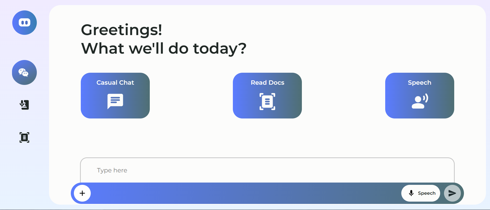
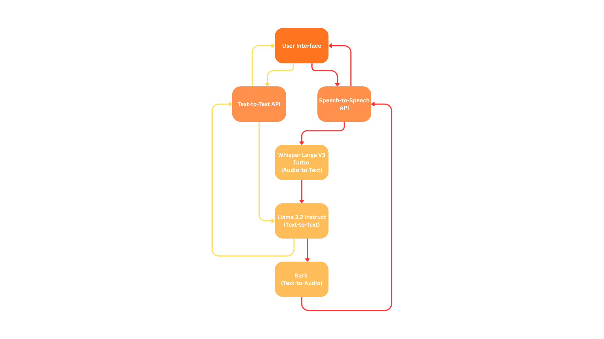
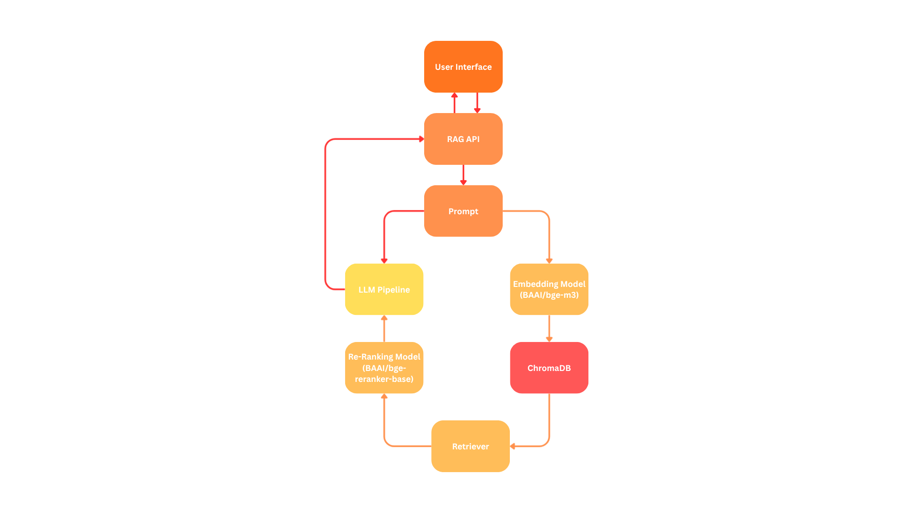
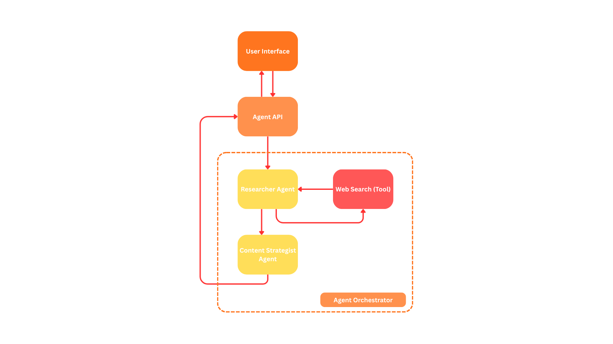

# **Personal Assistant Chatbot Powered by RAG and AI Agents**

## Table of Contents

[1. Table of Contents](#table-of-contents)
[2. About](#about)
[3. How Does it Works?](#how-does-it-works)
[4. Watch the Demo!](#watch-the-demo)

## About

This project aim to develop a web-based chatbot personal assistant. The chatbot is equipped with capabilites such as text-to-text, speech-to-speech, Retrieval Augmented Generation (RAG), and even AI Agents. This chatbot is intended to be used for help with daily tasks such as asking questions, explaining concepts, read documents, summarize documents, and also fetch informations from websites to generate grounded answer for research purposes.

## How Does it Works?

The entire chatbot system is divided into multiple parts. First, there are the usual text generation and speech-to-speech system, then, there is the Retrieval Augmented Generation system, and lastly, the agentic system.

### Text-to-Text and Speech-to-Speech System

### Retrieval Augmented Generation System

### Agentic System

## Watch the Demo!

